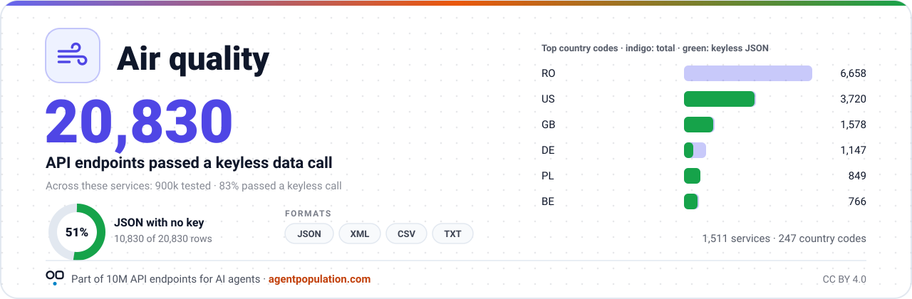
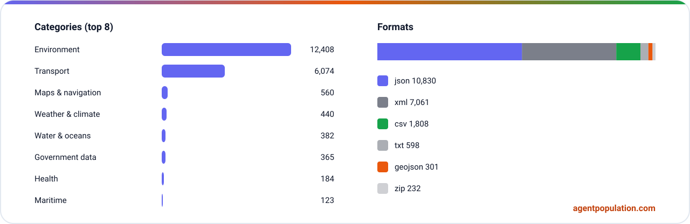

<p align="center"></p>

# 🌫️ Air quality API endpoints

**20,830 air-quality API endpoints that answered a keyless GET with a data body. For agent and app builders.**

<p align="center"><a href="#files"></a> <a href="#columns-and-tags"></a> <a href="#whats-inside"></a> <a href="#whats-inside"></a> <a href="LICENSE"></a></p>

<p align="center"><a href="#whats-in-it-for-you">What's in it</a> · <a href="#for-ai-agents">For AI agents</a> · <a href="#quick-start">Quick start</a> · <a href="#test-it-yourself">Test it yourself</a> · <a href="#files">Files</a> · <a href="#licence-and-credit">Licence</a> · <a href="#part-of-10m-api-endpoints-for-ai-agents">More packs</a></p>

This repository holds a 1,000-row sample and the services list; the full list of 20,830 endpoints is one download from the [latest release](https://github.com/agentpopulation/20k-air-quality-apis-for-agents/releases/latest).

**Endpoints for building an air-quality widget or agent.** Current PM2.5, PM10 and US AQI and hourly PM2.5, PM10, ozone and nitrogen dioxide by city, monitoring-station series in the UK and Belgium, German hourly and daily series by station and year, PM2.5 by country and pollution map layers, as URLs that answered with no key on their test date.

Selection rule: rows where `tags has air-quality`, less the rows that a leave-out rule drops (each counted under Known limits).

17,021 of these 20,830 rows match the focus rule (below); the others are in the pack by the selection rule only, and Known limits says what they are. 3,932 rows (18.9%) are map layers on ArcGIS Online, where anyone can publish.

## In plain words

**What is an API endpoint?** An API endpoint is one web address that a program can ask for data, for example the latest reading at one weather station. A single service, such as a national weather agency, can have thousands of endpoints: one per station, city or dataset. This pack counts endpoints, not separate services.

**What does "passed a data call" mean?** On the date shown in each row, AgentPopulation sent one plain request to that address, with no password or key, and got a non-empty data body back (JSON, CSV, XML or a file): not an error page and not an empty result. Some bodies describe a dataset rather than hold its values; see Known limits. It shows the address answered with data on that day. It is not a promise that it answers today, and licences and usage limits were not reviewed.

## What's in it for you

Four ways to use this pack. Each bucket gives a count, a filter you can apply to the CSV, one example that passed, and a list of recommended starting points with the rule that picked them. Buckets overlap; a row can fit more than one.

Examples, recommended lists and the preview are drawn from rows that match this pack's focus rule, so a row that the selection rule put in this pack but that is about something else is not shown as a starting point. Counts cover the whole bucket.

<details>
<summary>The focus rule</summary>

Focus rule: `title matches /\bair\b|air[ _-]?(quality|pollution|monitor)|airnow|luft|qualità dell'aria|qualita dell'aria|qaria|calidad del aire|qualité de l'air|pm ?2[._ ]?5|pm ?10|pm2|particulate|fine particles|ozon|nitrogen dioxide|\bno2\b|no₂|nitric oxide|sulphur dioxide|sulfur dioxide|\bso2\b|carbon monoxide|benzene|xylene|smog|pollut|emission|\baqi\b|aerosol|smoke|atmosph|ατμοσφ|ρύπ|περιβαλλοντικά δεδομένα/i AND NOT title matches /sea ?water|NO2-N|NO3-N/i AND NOT (title matches /water quality|water_quality|wq_|bathing water|drinking water|(?<!data )stream|wetland|swimmab|alkalinity|phosphorus/i AND NOT title matches /\bair\b|air[ _-]?quality|airnow|luft/i) AND NOT title matches /corridor overlay|transport air quality corridor|transport_air/i AND NOT title matches /deprecated|depcrecated|superseded|archived/i`

</details>

### 🤖 Agent tools: Pollutant lookups by city, station and country an agent can call

**8,148** endpoints from 783 services · Wrap one URL pattern as a get_air_quality tool: pass a latitude and longitude or a station series id, return PM2.5, PM10, ozone and NO2 with the time of the reading.

1,701 of these are station time-series descriptions (UK-AIR and IRCEL-CELINE) that hold the first and last value with timestamps; see Known limits.

Start with: `tags has agent-ready AND title matches /\bair\b|air[ _-]?(quality|pollution|monitor)|airnow|luft|qualità dell'aria|qualita dell'aria|qaria|calidad del aire|qualité de l'air|pm ?2[._ ]?5|pm ?10|pm2|particulate|fine particles|ozon|nitrogen dioxide|\bno2\b|no₂|nitric oxide|sulphur dioxide|sulfur dioxide|\bso2\b|carbon monoxide|benzene|xylene|smog|pollut|emission|\baqi\b|aerosol|smoke|atmosph|ατμοσφ|ρύπ|περιβαλλοντικά δεδομένα/i AND NOT url matches /request=getcapabilities/i`

Example: [Open-Meteo air quality: Quito, Ecuador](https://air-quality-api.open-meteo.com/v1/air-quality?latitude=-0.23&longitude=-78.52&current=pm10,pm2_5,us_aqi) · Open-Meteo air quality API · passed 2026-11-14

<details>
<summary>Recommended starting points: 8 services, picked by the stated criteria inside</summary>

**Recommended starting points.** Selected by stated criteria, not a ranking of quality: Services in this pack with the most endpoints that match this bucket and are tagged `agent-ready` (no key sent in the test call, JSON body, passed a data call). Ties go to the service with more country codes, then by name. Only services with at least one bucket row that matches the focus rule are listed, and the sample comes from those rows; the counts cover the whole bucket. The sample URL is the first row by URL sort after preferring, in this order: rows that match the bucket's sample preference when it has one, rows that return values rather than describe a dataset or a service (not ERDDAP /info/ pages, OGC GetCapabilities requests, bare OWS addresses, PxWeb tables, UN SDG series lists, Statistics Canada download pointers, WorldPop listings, GTFS validation reports, untitled rows or service root addresses), and agent-ready rows. Sample preference in this bucket: `url matches /air-quality-api\.open-meteo\.com/.*current=/i`. Services named "ArcGIS organization" hold map layers from many owners and are added only when fewer than 5 other services match.

| Service (host) | Endpoints in bucket | In pack | Country codes in bucket | Formats in bucket | Sample URL that passed |
|---|---:|---:|---|---|---|
| Open-Meteo air quality API (air-quality-api.open-meteo.com) | 1,043 | 1,043 | 242 codes | json | [Open-Meteo air quality: Quito, Ecuador](https://air-quality-api.open-meteo.com/v1/air-quality?latitude=-0.23&longitude=-78.52&current=pm10,pm2_5,us_aqi) (2026-11-14) |
| Defra (uk-air.defra.gov.uk) | 1,015 | 1,015 | GB | json | [UK-AIR (Defra) air quality: Bristol St …](https://uk-air.defra.gov.uk/sos-ukair/api/v1/timeseries/100) (2026-11-14) |
| Airgradient (api.airgradient.com) | 996 | 996 | 66 codes | json | [AirGradient: Current air quality: Romil…](https://api.airgradient.com/public/api/v1/world/locations/102812/measures/current) (2026-11-15) |
| Gios (api.gios.gov.pl) | 805 | 805 | PL | json | [GIOŚ (Chief Inspectorate of Environment…](https://api.gios.gov.pl/pjp-api/v1/rest/aqindex/getIndex/10005) (2026-11-15) |
| Irceline (geo.irceline.be) | 686 | 719 | BE | json | [IRCEL-CELINE air quality: 44RL01 - Roes…](https://geo.irceline.be/sos/api/v1/timeseries/100005) (2026-11-14) |
| www.umweltbundesamt.de | 370 | 804 | DE | json | [Ozon Altendeich 1-Stunden Mittelwert 20…](https://www.umweltbundesamt.de/api/air_data/v2/measures/json?station=1528&component=3&scope=2&date_from=2018-01-01&time_from=1&date_to=2018-12-31&time_to=24&lang=de) (2026-11-15) |
| Azureedge (ghoapi.azureedge.net) | 171 | 171 | 171 codes | json | [WHO GHO: Concentrations of fine particu…](https://ghoapi.azureedge.net/api/SDGPM25?$filter=SpatialDim%20eq%20%27ABW%27) (2026-11-14) |
| Open Data Portal / Queensland Government (data.qld.gov.au) | 93 | 95 | AU | json | [Air Quality Monitoring - 2020 (grouped …](https://data.qld.gov.au/api/3/action/datastore_search?resource_id=0704a2dd-639f-4e59-8b4f-d8482a1a54af&limit=1) (2026-11-15) |

</details>

### 📱 App features: Air-quality cards by city and pollution map layers

**4,751** endpoints from 1,023 services · Show PM2.5, PM10 and US AQI for a city on a card, and draw monitoring sites, pollution zones or modelled annual means as a map layer.

1,043 of these are city queries by latitude and longitude that return current or hourly pollutant values; the others are map layers.

Start with: `subcategory matches /^Air quality \((city|capital city)\)/i OR subcategory contains "ArcGIS feature layer" OR format is geojson`

Example: [Open-Meteo air quality: Quito, Ecuador](https://air-quality-api.open-meteo.com/v1/air-quality?latitude=-0.23&longitude=-78.52&current=pm10,pm2_5,us_aqi) · Open-Meteo air quality API · passed 2026-11-14

<details>
<summary>Recommended starting points: 8 services, picked by the stated criteria inside</summary>

**Recommended starting points.** Selected by stated criteria, not a ranking of quality: Services in this pack with the most endpoints that match this bucket and passed a data call. Ties go to the service with more country codes, then by name. Only services with at least one bucket row that matches the focus rule are listed, and the sample comes from those rows; the counts cover the whole bucket. The sample URL is the first row by URL sort after preferring, in this order: rows that match the bucket's sample preference when it has one, rows that return values rather than describe a dataset or a service (not ERDDAP /info/ pages, OGC GetCapabilities requests, bare OWS addresses, PxWeb tables, UN SDG series lists, Statistics Canada download pointers, WorldPop listings, GTFS validation reports, untitled rows or service root addresses), and agent-ready rows. Sample preference in this bucket: `subcategory matches /^Air quality \((city|capital city)\)/i`. Services named "ArcGIS organization" hold map layers from many owners and are added only when fewer than 5 other services match.

| Service (host) | Endpoints in bucket | In pack | Country codes in bucket | Formats in bucket | Sample URL that passed |
|---|---:|---:|---|---|---|
| Open-Meteo air quality API (air-quality-api.open-meteo.com) | 1,043 | 1,043 | 242 codes | json | [Open-Meteo air quality: Quito, Ecuador](https://air-quality-api.open-meteo.com/v1/air-quality?latitude=-0.23&longitude=-78.52&current=pm10,pm2_5,us_aqi) (2026-11-14) |
| Fairbanks North Star Borough (ArcGIS Online) (services.arcgis.com) | 236 | 366 | US | json | [Air Quality Control Zone](https://services.arcgis.com/f4rR7WnIfGBdVYFd/arcgis/rest/services/Air_Quality_Control_Zone/FeatureServer/0/query?where=1%3D1&outFields=*&returnGeometry=false&resultRecordCount=5&f=json) (2026-11-14) |
| U.S. EPA (ArcGIS Online) (services.arcgis.com) | 92 | 94 | US | json | [Nonattainment Area - 8 hr Ozone (1997 S…](https://services.arcgis.com/cJ9YHowT8TU7DUyn/ArcGIS/rest/services/Nonattainment_Areas_and_Designations/FeatureServer/0/query?where=1%3D1&outFields=*&returnGeometry=false&resultRecordCount=5&f=json) (2026-11-14) |
| California State University Long Beach - Geography (ArcGIS Online) (services3.arcgis.com) | 80 | 80 | US | json | [AirQualityMonitor\_JS](https://services3.arcgis.com/vq5vGR4r1YX7ueLg/arcgis/rest/services/AirQualityMonitor_JS/FeatureServer/0/query?where=1%3D1&outFields=*&returnGeometry=false&resultRecordCount=5&f=json) (2026-11-14) |
| Idaho Department of Environmental Quality GIS (ArcGIS Online) (services1.arcgis.com) | 57 | 69 | US | json | [AQI](https://services1.arcgis.com/Kr5oFycwwDsdTyVH/arcgis/rest/services/AQI/FeatureServer/0/query?where=1%3D1&outFields=*&returnGeometry=false&resultRecordCount=5&f=json) (2026-11-14) |
| Rcdo (ukair.maps.rcdo.co.uk) | 52 | 73 | GB | json | [PM10 annual mean Local Authority 2020](https://ukair.maps.rcdo.co.uk/ukairserver/rest/services/Hosted/PM10_annual_mean_Local_Authority_2020/FeatureServer/0/query?where=1%3D1&outFields=*&returnGeometry=false&resultRecordCount=5&f=json) (2026-11-14) |
| ArcGIS Online for Maryland (ArcGIS Online) (services.arcgis.com) | 45 | 60 | US | json | [Air Quality Index by County from 2005 t…](https://services.arcgis.com/njFNhDsUCentVYJW/arcgis/rest/services/Air_Quality_Index_by_County_from_2005_to_2025/FeatureServer/0/query?where=1%3D1&outFields=*&returnGeometry=false&resultRecordCount=5&f=json) (2026-11-14) |
| enterprise.gisdata.mn.gov | 39 | 39 | US | json | [MPCA Air Quality Permits](https://enterprise.gisdata.mn.gov/aghost/rest/services/us_mn_state_pca/env_air_quality_permits/FeatureServer/0/query?where=1%3D1&outFields=*&returnGeometry=false&resultRecordCount=5&f=json) (2026-11-14) |

</details>

### 🧠 Grounding and data pipelines: Hourly and annual pollutant series for scheduled loads

**10,260** endpoints from 189 services · Load station series and country PM2.5 figures on a schedule into your own store, so answers about air pollution cite a dated source.

804 of these are Umweltbundesamt series for one German station, one pollutant and one fixed year.

Start with: `format in (csv, xml, zip, txt) OR url contains "umweltbundesamt.de/api/air_data" OR subcategory contains "WHO Global Health Observatory"`

Example: [Ozon Altendeich 1-Stunden Mittelwert 2018 - DESH0…](https://www.umweltbundesamt.de/api/air_data/v2/measures/json?station=1528&component=3&scope=2&date_from=2018-01-01&time_from=1&date_to=2018-12-31&time_to=24&lang=de) · www.umweltbundesamt.de · passed 2026-11-15

<details>
<summary>Recommended starting points: 8 services, picked by the stated criteria inside</summary>

**Recommended starting points.** Selected by stated criteria, not a ranking of quality: Services in this pack with the most endpoints that match this bucket and passed a data call. Ties go to the service with more country codes, then by name. Only services with at least one bucket row that matches the focus rule are listed, and the sample comes from those rows; the counts cover the whole bucket. The sample URL is the first row by URL sort after preferring, in this order: rows that match the bucket's sample preference when it has one, rows that return values rather than describe a dataset or a service (not ERDDAP /info/ pages, OGC GetCapabilities requests, bare OWS addresses, PxWeb tables, UN SDG series lists, Statistics Canada download pointers, WorldPop listings, GTFS validation reports, untitled rows or service root addresses), and agent-ready rows. Sample preference in this bucket: `NOT url matches /request=getcapabilities/i AND title matches /nitrogen dioxide|pm ?10|pm ?2|particulate|ozon/i`. Services named "ArcGIS organization" hold map layers from many owners and are added only when fewer than 5 other services match.

| Service (host) | Endpoints in bucket | In pack | Country codes in bucket | Formats in bucket | Sample URL that passed |
|---|---:|---:|---|---|---|
| data.gov.ro | 6,640 | 6,640 | RO | xml | [data.gov.ro: Station RO0152A: List of v…](https://data.gov.ro/dataset/012c07d8-8bbe-4a58-a73e-740cdf52a7e6/resource/02564a96-0c3d-4822-ac21-c687ff3529c5/download/valori-validate-aferente-decembrie-anul-2008.xml) (2026-11-15) |
| www.umweltbundesamt.de | 804 | 804 | DE | csv, json | [Ozon Altendeich 1-Stunden Mittelwert 20…](https://www.umweltbundesamt.de/api/air_data/v2/measures/json?station=1528&component=3&scope=2&date_from=2018-01-01&time_from=1&date_to=2018-12-31&time_to=24&lang=de) (2026-11-15) |
| Seu E (dadesobertes.seu-e.cat) | 357 | 357 | ES | csv | [dadesobertes.seu-e.cat: Air quality at …](https://dadesobertes.seu-e.cat/dataset/0517c401-4ffd-49d7-a7ef-29912eb73b09/resource/01dd2fa3-5218-4c14-93a2-4da756a08485/download/01dd2fa3-5218-4c14-93a2-4da756a08485.csv) (2026-11-15) |
| Azureedge (ghoapi.azureedge.net) | 171 | 171 | 171 codes | json | [WHO GHO: Concentrations of fine particu…](https://ghoapi.azureedge.net/api/SDGPM25?$filter=SpatialDim%20eq%20%27ABW%27) (2026-11-14) |
| Navarra (datosabiertos.navarra.es) | 165 | 165 | ES | txt, csv | [datosabiertos.navarra.es: Air quality: …](https://datosabiertos.navarra.es/dataset/02065cdb-8219-4810-a4de-617ab708b5ff/resource/0e471a6b-8856-4a75-9fef-2b2681d4f7ed/download/leitza_2024.csv) (2026-11-15) |
| Open Data Regione Siciliana (dati.regione.sicilia.it) | 163 | 163 | IT | zip | [dati.regione.sicilia.it: ARPA air quali…](https://dati.regione.sicilia.it/download/dataset/arpa-qualita-aria-2010/filesystem/arpa-qualita-aria-2010-10_csv.zip) (2026-11-15) |
| Palermo (opendata.comune.palermo.it) | 153 | 153 | IT | xml, csv | [opendata.comune.palermo.it: AIR QUALITY…](https://opendata.comune.palermo.it/js/server/uploads/dataset/csv/_20022013170659.csv) (2026-11-15) |
| Public (download.data.public.lu) | 94 | 196 | LU | csv, xml, zip | [Administration de l'environnement: Air …](https://download.data.public.lu/resources/air-quality-non-telemetric-network/20240203-040026/pm2-5-2023.csv) (2026-11-15) |

</details>

### 🧪 Evals and testing: City queries, station series and files to test an air-quality tool

**20,830** endpoints · 1,511 services · 247 country codes · 6 formats · Run your air-quality tool against a fixed set of URLs across formats; check that pollutant, unit, value and timestamp parse, and keep last_tested as the baseline for your own re-tests.

Start with: the whole pack

Example: [Open-Meteo air quality: Quito, Ecuador](https://air-quality-api.open-meteo.com/v1/air-quality?latitude=-0.23&longitude=-78.52&current=pm10,pm2_5,us_aqi) · Open-Meteo air quality API · passed 2026-11-14

<details>
<summary>Recommended starting points: 8 services, picked by the stated criteria inside</summary>

**Recommended starting points.** Selected by stated criteria, not a ranking of quality: Services in this pack that returned the most different formats, then the most endpoints that passed a data call, then by name: a mix of response shapes to test parsers and tool calls. Only services with at least one bucket row that matches the focus rule are listed, and the sample comes from those rows; the counts cover the whole bucket. The sample URL is the first row by URL sort after preferring, in this order: rows that match the bucket's sample preference when it has one, rows that return values rather than describe a dataset or a service (not ERDDAP /info/ pages, OGC GetCapabilities requests, bare OWS addresses, PxWeb tables, UN SDG series lists, Statistics Canada download pointers, WorldPop listings, GTFS validation reports, untitled rows or service root addresses), and agent-ready rows. Services named "ArcGIS organization" hold map layers from many owners and are added only when fewer than 5 other services match.

| Service (host) | Endpoints in bucket | In pack | Country codes in bucket | Formats in bucket | Sample URL that passed |
|---|---:|---:|---|---|---|
| Public (download.data.public.lu) | 196 | 196 | LU | json, csv, xml, geojson, zip | [Administration de l'environnement: Air …](https://download.data.public.lu/resources/air-quality-geostatistical-interpolation/20261113-220157/lux-data-no2-1hour.json) (2026-11-15) |
| ArcGIS Online: Atmo Occitanie (data-atmo-occitanie.opendata.arcgis.com) | 53 | 53 | FR | csv, zip, xml, json | [data-atmo-occitanie.opendata.arcgis.com…](https://data-atmo-occitanie.opendata.arcgis.com/api/download/v1/items/9b907eb44e8c4212ac3e159e05f2696a/kml?layers=0) (2026-11-15) |
| ArcGIS Online: data (data-atmoaura.opendata.arcgis.com) | 31 | 31 | FR | csv, xml, json, geojson | [Atmo Auvergne-Rhône-Alpes: mes aura jou…](https://data-atmoaura.opendata.arcgis.com/api/download/v1/items/2708bbd3ff464850bc112032cee40525/geojson?layers=0) (2026-11-15) |
| Greece National Data Portal (gis.crete.gov.gr) | 6 | 6 | GR | csv, xml, geojson, json | [Εκπομπές Αιωρούμενων Σωματιδίων 10 (PM …](https://gis.crete.gov.gr/geoserver/wfs?service=WFS&version=2.0.0&request=GetFeature&typeNames=gisvec%3Aenv_pol_ekpompes_pm10&outputFormat=application%2Fjson) (2026-11-14) |
| Latvijas Atvērto datu portāls (data.gov.lv) | 28 | 28 | LV | json, csv, txt | [data.gov.lv: Annual report on air quali…](https://data.gov.lv/dati/dataset/8e50986a-87fd-42bf-8fb1-a24ae0488be6/resource/7d1d24c8-87d6-4204-a911-eaf8cf76dec8/download/ikgadjais-gaisa-kvalittes-prskats-2024.json) (2026-11-15) |
| Canada (open.canada.ca) | 26 | 26 | CA | csv, json, txt | [Ice arena air quality study datasets - …](https://open.canada.ca/data/api/3/action/datastore_search?resource_id=13fd1031-7dc6-463e-8948-4484334a4ac4&limit=1) (2026-11-15) |
| data.bl.ch | 26 | 26 | CH | json, csv, xml | [Air Quality Station Sissach West (half-…](https://data.bl.ch/api/v2/catalog/datasets/10910/exports/json) (2026-11-14) |
| Greece National Data Portal (services.chalandri.gr) | 22 | 22 | GR | xml, csv, geojson | [Εκπομπές Αιωρούμενων Σωματιδίων 10 (PM …](https://services.chalandri.gr/geoserver/Dimos_Chalandriou/wfs?service=WFS&version=2.0.0&request=GetFeature&typeNames=Dimos_Chalandriou%3Aenv_pol_agri_sub_pm10&outputFormat=KML) (2026-11-14) |

</details>

The same lists are in [recommended.json](recommended.json), ready for an agent to load.

## Questions an agent can answer with this pack

- What are the current PM2.5, PM10 and US AQI in a capital city? Try [Open-Meteo air quality: Quito, Ecuador](https://air-quality-api.open-meteo.com/v1/air-quality?latitude=-0.23&longitude=-78.52&current=pm10,pm2_5,us_aqi) (Open-Meteo air quality API, passed 2026-11-14).
- What was the last nitrogen dioxide value reported at a UK monitoring station, and when? Try [UK-AIR (Defra) air quality: Brighton Preston Park…](https://uk-air.defra.gov.uk/sos-ukair/api/v1/timeseries/103) (Defra, passed 2026-11-14).
- What were the hourly nitrogen dioxide values at a German station in a given year? Try [Nitrogen dioxide Bornhöved 1-hour average 2017](https://www.umweltbundesamt.de/api/air_data/v2/measures/json?station=1535&component=5&scope=2&date_from=2017-01-01&time_from=1&date_to=2017-12-31&time_to=24&lang=de) (www.umweltbundesamt.de, passed 2026-11-14).
- What PM2.5 concentration does the WHO Global Health Observatory give for a country? Try [WHO GHO: Concentrations of fine particulate matte…](https://ghoapi.azureedge.net/api/SDGPM25?$filter=SpatialDim%20eq%20%27ABW%27) (Azureedge, passed 2026-11-14).

## What "passed a data call" means

> [!NOTE]
> On the date in `last_tested` (IST), one GET to the URL, sent with no key, returned HTTP 2xx and a non-empty data body. HTML pages and empty results did not pass. The `format` column records what came back. This is a test result for that date, not a promise that the URL answers today. Licences, terms, rate limits, accuracy and freshness were not reviewed. Endpoints are URLs, not separate APIs; many share one service. This pack was tested 10–15 Nov 2026; snapshot 15 Nov 2026.

## For AI agents

Start from keyless JSON endpoints (`agent-ready`). The code below loads `recommended.json` and calls the first recommended service in the Agent tools bucket, with a timeout (`node examples/agent-start.mjs --recommended`). With no argument, `node examples/agent-start.mjs` calls the most recently tested agent-ready row of the sample; pass a `.csv` or `.csv.gz` path to use that file instead. See [examples/agent-start.mjs](examples/agent-start.mjs).

```js
// Node 18+. Loads recommended.json (the local copy, or the raw file on GitHub) and calls one keyless JSON endpoint.
import fs from 'node:fs';

const RAW = 'https://raw.githubusercontent.com/agentpopulation/20k-air-quality-apis-for-agents/main/recommended.json';
const rec = fs.existsSync('recommended.json')
  ? JSON.parse(fs.readFileSync('recommended.json', 'utf8'))
  : await (await fetch(RAW)).json();

const pick = rec.buckets.find((b) => b.id === 'agent').services[0];
try {
  const res = await fetch(pick.sample_url, {
    headers: { 'User-Agent': 'agent-example/1.0' },
    signal: AbortSignal.timeout(15000),
  });
  console.log(pick.service, res.status, res.headers.get('content-type'));
  console.log((await res.text()).slice(0, 300));
} catch (err) {
  console.log(`did not answer now; last passed ${pick.sample_last_tested} (${err.message})`);
}
```

How an agent picks an endpoint:

1. Filter to `agent-ready` and your country or topic.
2. Prefer the newest `last_tested` and the larger services.
3. Call with a timeout and check the body before you use it.

## Quick start

The examples run against the sample in `data/` out of the box (1,000 rows). Each takes an optional path to a `.csv` or `.csv.gz` file instead.

```bash
git clone https://github.com/agentpopulation/20k-air-quality-apis-for-agents.git
cd 20k-air-quality-apis-for-agents
python examples/quickstart.py
node examples/quickstart.mjs
node examples/agent-start.mjs
```

Full list: download `Air_Quality_API_Endpoints_AgentPopulation_Snapshot_2026-11-15.csv.gz` (20,830 rows, 986.3 kB) from [releases/latest](https://github.com/agentpopulation/20k-air-quality-apis-for-agents/releases/latest), then gunzip it and pass its path. The scripts also read the `.csv.gz` as it is.

```bash
gunzip Air_Quality_API_Endpoints_AgentPopulation_Snapshot_2026-11-15.csv.gz
python examples/quickstart.py Air_Quality_API_Endpoints_AgentPopulation_Snapshot_2026-11-15.csv
node examples/quickstart.mjs Air_Quality_API_Endpoints_AgentPopulation_Snapshot_2026-11-15.csv
```

### curl

Quote the URL: some contain commas.

```bash
curl -sL "https://raw.githubusercontent.com/agentpopulation/20k-air-quality-apis-for-agents/main/data/Air_Quality_API_Endpoints_AgentPopulation_Sample.csv" | head -n 4
curl -s --max-time 15 "https://air-quality-api.open-meteo.com/v1/air-quality?latitude=-0.23&longitude=-78.52&current=pm10,pm2_5,us_aqi" | head -c 600
```

### Python

Standard library only: [examples/quickstart.py](examples/quickstart.py) reads the sample, or the path you pass, keeps agent-ready rows and calls the most recently tested one.

<details>
<summary>The code</summary>

```python
# Python 3, standard library only. Run from a clone of this repository:
#   python examples/quickstart.py [path]
# With no path it reads the sample in data/. Pass the full list from the latest release (.csv or .csv.gz) instead.
# Keeps agent-ready rows and calls the most recently tested one.
import csv
import gzip
import os
import re
import sys
import urllib.request

HERE = os.path.dirname(os.path.abspath(__file__))
path = sys.argv[1] if len(sys.argv) > 1 else os.path.join(HERE, "..", "data", "Air_Quality_API_Endpoints_AgentPopulation_Sample.csv")
opener = gzip.open if path.endswith(".gz") else open
with opener(path, "rt", newline="", encoding="utf-8") as f:
    rows = list(csv.DictReader(f))

agent = [r for r in rows if "agent-ready" in r["tags"].split("|")]
# Newest test date first; URLs that describe a dataset or a service rather than return values go last.
DESCRIBES = re.compile(r"/erddap/info/|action-report\.json$|[?&]request=getcapabilities|/GeoArea/[^/?]+/List|getFullTableDownloadCSV|hub\.worldpop\.org", re.I)
agent.sort(key=lambda r: r["last_tested"], reverse=True)
agent.sort(key=lambda r: 1 if DESCRIBES.search(r["url"]) else 0)
print(len(rows), "rows,", len(agent), "agent-ready")
if not agent:
    sys.exit(0)

row = agent[0]
req = urllib.request.Request(row["url"], headers={"User-Agent": "agent-example/1.0"})
try:
    with urllib.request.urlopen(req, timeout=15) as res:
        body = res.read(1_000_000).decode("utf-8", "replace")
        print(res.status, res.headers.get("Content-Type"))
        print(body[:300])
except Exception as err:
    print(f"did not answer now; last passed {row['last_tested']} ({err})")
```

</details>

### JavaScript

Reads the sample as JSON because the CSV has quoted commas.

<details>
<summary>The code</summary>

```js
// Node 18+. Reads the sample as JSON (the CSV has quoted commas), local file first.
import fs from 'node:fs';

const FILE = 'data/Air_Quality_API_Endpoints_AgentPopulation_Sample.json';
const rows = fs.existsSync(FILE)
  ? JSON.parse(fs.readFileSync(FILE, 'utf8'))
  : await (await fetch('https://raw.githubusercontent.com/agentpopulation/20k-air-quality-apis-for-agents/main/data/Air_Quality_API_Endpoints_AgentPopulation_Sample.json')).json();

const row = rows.find((r) => r.tags.includes('agent-ready'));
const res = await fetch(row.url, { headers: { 'User-Agent': 'agent-example/1.0' }, signal: AbortSignal.timeout(15000) });
console.log(res.status, (await res.text()).slice(0, 300));
```

</details>

### Agent tools

[examples/agent-tools.json](examples/agent-tools.json) holds two tool definitions in the shape most tool-calling APIs accept (name, description, JSON Schema); rename `parameters` if yours uses another key. [examples/quickstart.mjs](examples/quickstart.mjs) implements them:

- `find_endpoints` searches the agent-ready rows of the list by words, country code (their format is json). When you load the tools of more than one pack, prefix the names (for example `air_quality_find_endpoints`) so they do not clash.
- `fetch_endpoint` calls one URL, **refuses any URL that is not in the list** and does not follow redirects. The allowlist is built from the CSV, so a URL injected into a prompt is refused.

The same two tools can sit behind an MCP server.

## Test it yourself

Re-test endpoints from the sample with the same rule: HTTP 2xx and a non-empty body that is not an HTML page. Node 18+, no packages.

```bash
node tools/test-endpoints.mjs
```

It tests the first 50 URLs and prints one line: tested, passed, did not pass. Options: a `.csv` or `.csv.gz` path (the full list from the release), `--limit 50`, `--timeout-ms 10000`, `--out results.csv`. The results file holds `url`, `status`, `passed`, `content_type`, `ms` and `checked_at`; a status of `timeout` or `error:<code>` means no HTTP answer came back. It is polite: GET only, no key sent, at most 4 requests in flight, one at a time per listed host, at least 1 second between requests to one listed host, and reading stops once 256 kB of a body is kept. Redirects are followed and may lead to another host. `results.csv` is in `.gitignore`.

## Preview

One row from each of the five largest services among rows that match the focus rule, services with rows that return values first.

| Title | Service | Country | Format | Tested | Link |
|---|---|---|---|---|---|
| data.gov.ro: Station RO0152A: List of validated air quality… | data.gov.ro | RO | xml | 2026-11-15 | [data.gov.ro](https://data.gov.ro/dataset/012c07d8-8bbe-4a58-a73e-740cdf52a7e6/resource/02564a96-0c3d-4822-ac21-c687ff3529c5/download/valori-validate-aferente-decembrie-anul-2008.xml) |
| Open-Meteo air quality: Quito, Ecuador | Open-Meteo air quality API | EC | json | 2026-11-14 | [air-quality-api.open-meteo.com](https://air-quality-api.open-meteo.com/v1/air-quality?latitude=-0.23&longitude=-78.52&current=pm10,pm2_5,us_aqi) |
| UK-AIR (Defra) air quality: Bristol St Paul's-Nitrogen oxid… | Defra | GB | json | 2026-11-14 | [uk-air.defra.gov.uk](https://uk-air.defra.gov.uk/sos-ukair/api/v1/timeseries/100) |
| AirGradient: Current air quality: Romiley | Airgradient | GB | json | 2026-11-15 | [api.airgradient.com](https://api.airgradient.com/public/api/v1/world/locations/102812/measures/current) |
| GIOŚ (Chief Inspectorate of Environmental Protection, Polan… | Gios | PL | json | 2026-11-15 | [api.gios.gov.pl](https://api.gios.gov.pl/pjp-api/v1/rest/aqindex/getIndex/10005) |

Browse the 1,000-row sample: [Sample CSV](data/Air_Quality_API_Endpoints_AgentPopulation_Sample.csv) · [Sample JSON](data/Air_Quality_API_Endpoints_AgentPopulation_Sample.json).

## What's inside

<p align="center"></p>

<details>
<summary>Country codes: 247</summary>

| Code | Country | Endpoints | |
|---|---|---:|---|
| RO | Romania | 6,658 | `████████████████████` |
| US | United States | 3,720 | `███████████▏` |
| GB | United Kingdom | 1,578 | `████▊` |
| DE | Germany | 1,147 | `███▌` |
| PL | Poland | 849 | `██▌` |
| BE | Belgium | 766 | `██▎` |
| ES | Spain | 681 | `██` |
| IT | Italy | 649 | `██` |
| HK | Hong Kong | 495 | `█▌` |
| AU | Australia | 374 | `█▏` |
| | other 237 codes | 3,606 | |
| | global or unknown | 307 | `▉` |

</details>

<details>
<summary>Categories: top 8</summary>

| Category | Endpoints | |
|---|---:|---|
| Environment | 12,408 | `████████████████████` |
| Transport & Mobility | 6,074 | `█████████▊` |
| Navigation & Geo/Maps | 560 | `▉` |
| Weather & Climate | 440 | `▊` |
| Hydrology & Oceans | 382 | `▋` |
| Government & Open Data | 365 | `▋` |
| Health | 184 | `▎` |
| Maritime | 123 | `▎` |

</details>

Formats: json 10,830 · xml 7,061 · csv 1,808 · txt 598 · geojson 301 · zip 232

<details>
<summary>Largest services: top 25 of 1,511</summary>

| Service | Host | Endpoints | Keyless JSON | |
|---|---|---:|---:|---|
| data.gov.ro | data.gov.ro | 6,640 | 0 | `████████████████████` |
| Open-Meteo air quality API | air-quality-api.open-meteo.com | 1,043 | 1,043 | `███▏` |
| Defra | uk-air.defra.gov.uk | 1,015 | 1,015 | `███` |
| Airgradient | api.airgradient.com | 996 | 996 | `███` |
| Gios | api.gios.gov.pl | 805 | 805 | `██▍` |
| www.umweltbundesamt.de | www.umweltbundesamt.de | 804 | 390 | `██▍` |
| Irceline | geo.irceline.be | 719 | 686 | `██▏` |
| Aqhi † | www.aqhi.gov.hk | 452 | 0 | `█▍` |
| Fairbanks North Star Borough (ArcGIS Online) | services.arcgis.com | 366 | 366 | `█▏` |
| Seu E | dadesobertes.seu-e.cat | 357 | 0 | `█▏` |
| Public | download.data.public.lu | 196 | 93 | `▋` |
| Azureedge | ghoapi.azureedge.net | 171 | 171 | `▌` |
| Navarra | datosabiertos.navarra.es | 165 | 0 | `▌` |
| Open Data Regione Siciliana | dati.regione.sicilia.it | 163 | 0 | `▌` |
| Palermo | opendata.comune.palermo.it | 153 | 0 | `▌` |
| BrisMAP Public (ArcGIS Online) † | services2.arcgis.com | 120 | 120 | `▍` |
| iot.comune.fe.it † | iot.comune.fe.it | 118 | 118 | `▍` |
| ArcGIS Online layers (services-ap1.arcgis.com, org wYEzTTDGwSuQQW1R) | services-ap1.arcgis.com | 110 | 110 | `▍` |
| BSH geospatial data (Germany) † | gdi.bsh.de | 95 | 0 | `▎` |
| Open Data Portal / Queensland Government | data.qld.gov.au | 95 | 95 | `▎` |
| U.S. EPA (ArcGIS Online) | services.arcgis.com | 94 | 94 | `▎` |
| OpenData Milano | dati.comune.milano.it | 91 | 45 | `▎` |
| South Australian Government Data Directo | data.sa.gov.au | 90 | 90 | `▎` |
| Europa | air.discomap.eea.europa.eu | 86 | 86 | `▎` |
| Gencat † | sig.gencat.cat | 81 | 2 | `▎` |

† No row of these services matches the focus rule: the selection rule put them in this pack, so they are not used as a starting point.

</details>

<details>
<summary>Rows per test date: 10–15 Nov 2026</summary>

| Date (IST) | Endpoints | |
|---|---:|---|
| 2026-11-15 | 12,895 | `████████████████████` |
| 2026-11-14 | 7,637 | `███████████▉` |
| 2026-11-13 | 23 | `▏` |
| 2026-11-12 | 205 | `▍` |
| 2026-11-11 | 69 | `▏` |
| 2026-11-10 | 1 | `▏` |

</details>

## Files

| File | Rows | Size | Use |
|---|---:|---:|---|
| [data/Air_Quality_API_Services_AgentPopulation.csv](data/Air_Quality_API_Services_AgentPopulation.csv) | 1,511 | 90.5 kB | One row per service with its endpoint count in this pack |
| [data/Air_Quality_API_Endpoints_AgentPopulation_Sample.csv](data/Air_Quality_API_Endpoints_AgentPopulation_Sample.csv) | 1,000 | 340.3 kB | The sample: focus-rule rows first, each service in proportion to its share; ArcGIS Online layers count as one service |
| [data/Air_Quality_API_Endpoints_AgentPopulation_Sample.json](data/Air_Quality_API_Endpoints_AgentPopulation_Sample.json) | 1,000 | 534.8 kB | The same rows as JSON, tags as an array |
| [Air_Quality_API_Endpoints_AgentPopulation_Snapshot_2026-11-15.csv.gz](https://github.com/agentpopulation/20k-air-quality-apis-for-agents/releases/latest) | 20,830 | 986.3 kB | The full list, gzipped CSV: a download from the latest release, checked by `SHA256SUMS.txt` |
| [tools/test-endpoints.mjs](tools/test-endpoints.mjs) | | | Re-tests endpoints from the sample or the full list |

Sample size: 1,000 rows, which is 1,000 or one third of the pack rounded down, whichever is smaller. Rows that match the focus rule come first. Each service gets rows in proportion to its share of those rows, at least one for the largest services and at most 50% of the sample while other services have rows; ArcGIS Online layers count as one service, whatever their organisation. Within a service, agent-ready rows, rows that return values and the newest test dates come first, and rows are written in turn across services. Service root addresses are placed at the end of the sample.

Full list: download `Air_Quality_API_Endpoints_AgentPopulation_Snapshot_2026-11-15.csv.gz` (20,830 rows, 986.3 kB) from [releases/latest](https://github.com/agentpopulation/20k-air-quality-apis-for-agents/releases/latest), then gunzip it and pass its path. The scripts also read the `.csv.gz` as it is.

Excel users: Data > From Text/CSV, UTF-8. Files are UTF-8 without a byte-order mark and comma-separated.

## Columns and tags

<details>
<summary>Columns, types and tags</summary>

| Column | Type | Example | Meaning |
|---|---|---|---|
| url | string | [https://data.gov.ro/dataset/012c07d8-8b…](https://data.gov.ro/dataset/012c07d8-8bbe-4a58-a73e-740cdf52a7e6/resource/02564a96-0c3d-4822-ac21-c687ff3529c5/download/valori-validate-aferente-decembrie-anul-2008.xml) | The address that was tested |
| title | string | data.gov.ro: Station RO0152A: List of v… | Station, dataset or feed name |
| service | string | data.gov.ro | The service the endpoint belongs to; joins to the services file together with host |
| host | string | data.gov.ro | Host name of the address |
| country | string | RO | ISO 3166-1 alpha-2 code, or EU; empty when global or unknown |
| category | string | Transport & Mobility | Category of the endpoint |
| subcategory | string |  | Left empty from the 15 Nov 2026 snapshot; kept so the columns stay the same |
| format | string | xml | What the test call returned: json, csv, geojson, xml, gtfs, zip, txt and so on |
| tags | string | `transit\|air-quality\|no-key\|xml` | Tags separated by \| |
| last_tested | date | 2026-11-15 | Date of the test call, YYYY-MM-DD (IST) |

| Tag | Rows | Meaning |
|---|---:|---|
| air-quality | 20,830 | Topic tag |
| no-key | 20,830 | No key was sent in the test call |
| environment | 12,586 | Topic tag |
| agent-ready | 10,830 | No key sent, JSON body, passed a data call on last_tested |
| json | 10,830 | Format of the body |
| xml | 7,061 | Format of the body |
| transit | 6,111 | Topic tag |
| maps | 5,182 | Topic tag |
| open-data | 2,299 | Topic tag |
| csv | 1,808 | Format of the body |
| weather | 1,505 | Topic tag |
| government | 920 | Topic tag |
| health | 707 | Topic tag |
| water | 382 | Topic tag |
| science | 314 | Topic tag |
| geojson | 301 | Format of the body |
| statistics | 144 | Topic tag |
| maritime | 126 | Topic tag |
| energy | 118 | Topic tag |
| climate | 86 | Topic tag |
| rivers | 84 | Topic tag |
| hazards | 57 | Topic tag |
| traffic | 30 | Topic tag |
| oceans | 25 | Topic tag |
| aviation | 16 | Topic tag |
| forecast | 15 | Topic tag |
| wildfire | 15 | Topic tag |
| economy | 12 | Topic tag |
| finance | 5 | Topic tag |
| groundwater | 5 | Topic tag |
| tides | 5 | Topic tag |
| floods | 3 | Topic tag |
| geocoding | 3 | Topic tag |
| mcp-server | 2 | Topic tag |
| parking | 1 | Topic tag |

A machine-readable copy of this dictionary is in [datapackage.json](datapackage.json).

</details>

## Known limits

- 32.0% of rows carry country code RO; 307 rows have no code (global or unknown).
- 13 rows come from PxWeb or Statistics Canada services. Some statistics endpoints return metadata or a pointer on GET; the table may need a second request or a POST.
- 13 rows are ERDDAP /info/ pages: they describe a dataset rather than return its values, so the series needs a second request.
- 4,457 rows are map-layer queries with resultRecordCount set: the tested call asked for a few records; change the query to get the full layer.
- 396 rows carry limit=1: the tested call asked for one record; raise the limit or page through.
- 301 rows are open-data portal dataset records, which may return a dataset record with links rather than the table itself.
- 830 rows are files (zip 232, txt 598) rather than bodies an agent reads directly.
- 1 row is a service root address (the host alone or an API or version path such as /v1, with no query), which may describe the service rather than return data; the sample, examples and recommended lists use other rows first.
- 3,932 rows are layers on ArcGIS Online, where anyone can publish: some are class projects, tests or copies. Check the owner and the fields before you rely on one.
- 3,583 rows carry the air-quality tag but have no air or pollutant term in the title; many are water-quality, soil, permit or planning layers. Check the title before you use one; they are not used as starting points.
- 275 rows have a water-quality, stream or wetland term and no air term in the title: water, not air.
- 95 rows are nitrite and nitrate in seawater (Germany), tagged by the NO2 or NO3 in their names; they are not air measurements.
- 124 rows are Brisbane City Plan overlays (transport air-quality corridors and ventilation stacks), planning zones rather than measurements; many are marked Superseded.
- 1,701 rows are station time-series descriptions (UK-AIR and IRCEL-CELINE): the body holds the station, pollutant, unit and the first and last value with timestamps. Some series ended years ago; check the lastValue timestamp before you show it as current.
- 804 rows are Umweltbundesamt queries for one station, one pollutant and one fixed year; change date_from and date_to for another period.
- 357 rows are "Sniffer" run layers dated 2013 to 2018, most named after places around Fairbanks and North Pole, Alaska; one layer per run or survey period.
- 73 rows are OGC GetCapabilities requests: they list the layers of a map service rather than return measurements.
- 127 rows are layers marked deprecated, superseded or archived in their own title; they are not used as starting points.
- Some map layers carry a country code that does not match the place in their title (Jakarta layers coded US or AU); check the title or the host when you filter by country.
- Stations and feeds can go quiet after their test date; re-test a URL before you rely on it.
- Not in this pack: endpoints that need a key or a POST, and URLs that did not pass.
- Left out: 158 ArcGIS Survey123 layers (they can hold people's form answers).
- Left out: 1 layer marked editable in the title (it can hold entries that people added).
- Left out: 20 ArcGIS layers that keep a form's default service name (they can hold people's form answers).
- Left out: 277 ArcGIS class or coursework layers (lab, assignment, exam, quiz, lesson, exercise, tutorial and final-project layers, copies of class layers, layers named for a person or a person's home, and layers whose name ends in a person's name or holds a student number).
- Left out: 5 ArcGIS layers that hold reports, comments, submissions or form responses sent in by the public.

## Licence and credit

> [!IMPORTANT]
> This list (URLs, titles, tags and test results) is © 2026 AgentPopulation, released under [CC BY 4.0](https://creativecommons.org/licenses/by/4.0/). Credit AgentPopulation and link agentpopulation.com. The data each endpoint returns belongs to its provider and stays under that provider's terms; this licence does not cover it.

Copy-ready credit:

`Air quality API endpoints by AgentPopulation (https://agentpopulation.com), CC BY 4.0, snapshot 15 Nov 2026.`

GitHub's "Cite this repository" button reads [CITATION.cff](CITATION.cff).

<!-- agentpopulation:start -->
## Part of 10M API endpoints for AI agents

This pack is one of the 24 topic packs of [10m-open-apis-for-ai-agents](https://github.com/agentpopulation/10m-open-apis-for-ai-agents), the open collection by [AgentPopulation](https://agentpopulation.com). Target: 10 million+ open API endpoints that pass a keyless API call.

AgentPopulation has tested over 5 million API endpoints: 5,129,834 tested, 3,726,509 passed a data call (snapshot 15 Nov 2026). This is the air-quality pack: 20,830 endpoints from 1,511 services. Packs overlap, so an endpoint can appear in more than one.

For the latest tested endpoints, search [agentpopulation.com/apis](https://agentpopulation.com/apis). This pack is a snapshot from 15 Nov 2026.

Sibling packs that share the most URLs with this one: [190k-weather-apis-for-agents](https://github.com/agentpopulation/190k-weather-apis-for-agents) (20,830 shared) · [170k-environment-apis-for-agents](https://github.com/agentpopulation/170k-environment-apis-for-agents) (12,408 shared) · [2.5m-agent-ready-apis](https://github.com/agentpopulation/2.5m-agent-ready-apis) (10,830 shared) · [270k-transit-apis-for-agents](https://github.com/agentpopulation/270k-transit-apis-for-agents) (6,112 shared) · [380k-maps-gis-apis-for-agents](https://github.com/agentpopulation/380k-maps-gis-apis-for-agents) (560 shared) · [270k-water-apis-for-agents](https://github.com/agentpopulation/270k-water-apis-for-agents) (400 shared). The rest are listed in [10m-open-apis-for-ai-agents](https://github.com/agentpopulation/10m-open-apis-for-ai-agents).

Questions, pack requests, reports of endpoints that stopped answering and requests to remove a row go to [Discussions](https://github.com/agentpopulation/10m-open-apis-for-ai-agents/discussions), or to [@agentpopulation](https://x.com/agentpopulation) on X. The packs are a work in progress and corrections are welcome.

Spotted a wrong row or a dead URL? Tell us on X: [@agentpopulation](https://x.com/agentpopulation).

If this pack saved you time, a star helps others find it.

---

Compiled by [AgentPopulation](https://agentpopulation.com) with [AP Desk](https://github.com/agentpopulation/apdesk) · [10m-open-apis-for-ai-agents](https://github.com/agentpopulation/10m-open-apis-for-ai-agents)

<!-- agentpopulation:end -->
